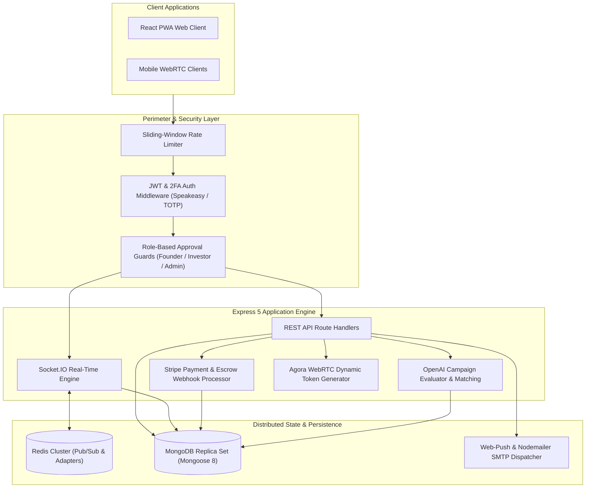

# 🌐 TrustBridgeAI — Distributed Real-Time Backend Engine

<p align="center">
  
  
  
  
  
  
  
  
</p>
<br/>

> **TrustBridgeAI Backend** is a high-concurrency, distributed server-side engine designed for early-stage startup deal negotiations, real-time escrow, and investor-founder collaboration. It features horizontal WebSocket clustering over Redis, dynamic WebRTC signaling via Agora, and automated startup risk scoring with OpenAI.

---

## 🏗️ System Architecture



---

## ⚡ Core Engineering Highlights

- **Horizontal WebSocket Scaling**: Configured with `@socket.io/redis-adapter` and Redis pub/sub channels, enabling stateless multi-instance backend clustering and synchronized room broadcast events.
- **Enterprise-Grade Two-Factor Security**: Time-based One-Time Password (TOTP) enforcement using `speakeasy` and QR codes, paired with cryptographically signed JWTs and role-based approval middleware.
- **Live Video & Audio Signaling**: Dynamic RTC token generation for WebRTC audio/video rooms powered by Agora SDK, ensuring zero persistent credentials exposed to client devices.
- **AI-Powered Deal Scoring & Chat**: Multi-stage OpenAI evaluation pipelines analyzing startup decks, risk metrics, and investor preferences with rate-guarded retry loops.
- **Robust Financial Integrations**: Webhook-driven Stripe checkout sessions with idempotency keys and asynchronous transaction state machines recorded in MongoDB.

---

## 📁 Repository Structure

```text
app/
  config/               Database connections, Agora tokens, and OpenAI prompts
  middleware/           Auth guards, 2FA validation, rate limiters, approval checks
  models/               Mongoose domain schemas (Deals, Campaigns, RiskEvents, Messages)
  routes/               Modular route controllers (Admin, AI, Deals, Webhooks)
index.js                Server initialization, HTTP server, and Redis Socket.IO adapter
```

---

## 🚀 Quick Start & Local Setup

### Prerequisites
- Node.js >= 20.0.0
- MongoDB >= 6.0
- Redis >= 7.0

### 1. Installation
```bash
git clone https://github.com/DanishAjma1/TrustBridgeAI-Backend.git
cd TrustBridgeAI-Backend
npm install
```

### 2. Environment Configuration
Create a `.env` file in the project root:
```env
PORT=5000
MONGO_URI="mongodb://localhost:27017/trustbridge"
REDIS_URL="redis://localhost:6379"
JWT_SECRET="your-jwt-secret-key"
OPENAI_API_KEY="your-openai-api-key"
STRIPE_SECRET_KEY="your-stripe-secret"
STRIPE_WEBHOOK_SECRET="your-stripe-webhook-secret"
AGORA_APP_ID="your-agora-app-id"
AGORA_APP_CERTIFICATE="your-agora-app-certificate"
```

### 3. Run Development Server
```bash
npm run dev
```
The backend starts with live reload on `http://localhost:5000`.

---

## 📜 License
Distributed under the ISC License. Built by [Danish Ajmal](https://github.com/DanishAjma1).
